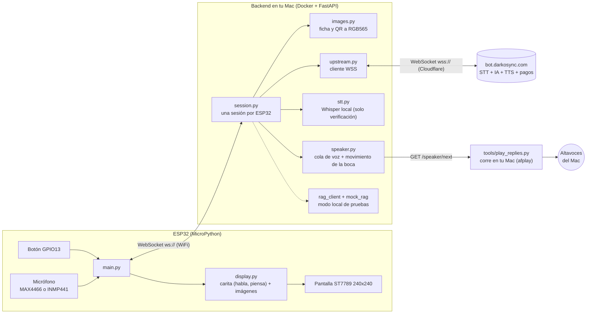
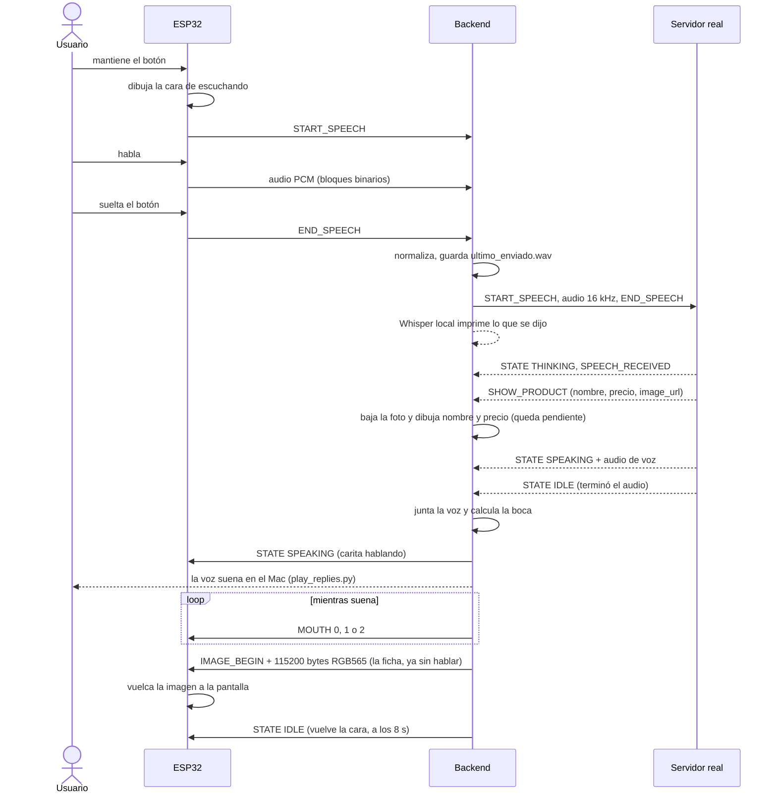
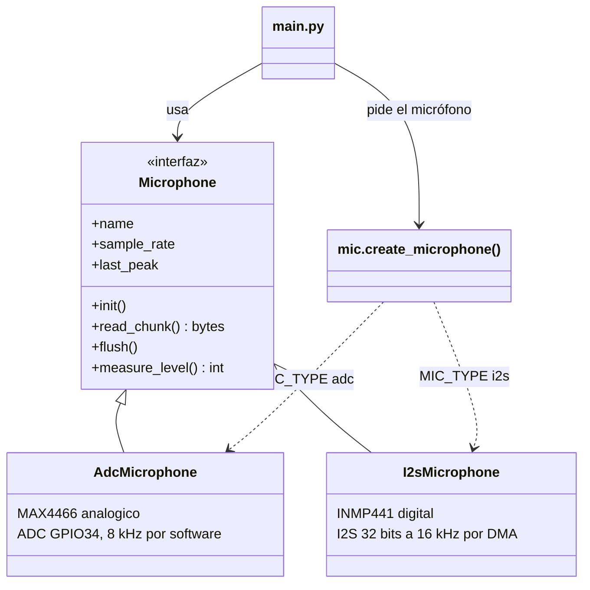

# VoloBot AI: cómo está hecho

Agente de voz con botón sobre un ESP32 (MicroPython). Se mantiene un botón, se habla, y la respuesta
del servidor se muestra en una pantallita de 240×240. **No hay parlante**: todo se ve en pantalla.

## 1. Vista general



## 2. Qué pasa en una pregunta



## 3. Eventos del servidor y qué se hace con cada uno

Todo se decide por el campo `type` del mensaje (ver `especificacion_equipo_iot_esp32.md`).

| `type` del servidor | Qué hace el backend | Lo que ve el ESP32 |
| --- | --- | --- |
| `STATE` `THINKING` | lo reenvía | carita pensando ("PENSANDO...") |
| audio binario (voz del bot) | lo junta completo, lo deja en la cola del reproductor y calcula el movimiento de la boca | carita **hablando** mientras suena en el Mac |
| `STATE` `IDLE` | marca el fin de la respuesta: habla si hay voz, o muestra lo pendiente | ver abajo |
| `SHOW_PRODUCT` | baja la foto y dibuja nombre y precio; la **retiene** hasta que termine de hablar | imagen 240×240 durante 8 s, **al terminar de hablar** |
| `SHOW_QR` | baja el QR y le pone "TOTAL: Bs. XX"; la retiene igual | imagen con el QR durante 60 s, al terminar de hablar |
| `PAYMENT_CONFIRMED` | **se ignora** (`SHOW_PAYMENT_CONFIRMED=false`) | nada |
| `SPEECH_RECEIVED`, `PONG` | acuses, sin contenido | nada |
| el servidor no responde, o no hay conexión | corta a los 45 s o al instante | **carita triste** 2,5 s |

Tras hablar: si había una ficha o QR pendiente se muestra; si no, vuelve la cara en reposo. **Ya no se pone
texto en la pantalla**: los avisos se muestran con la expresión de la carita. (El modo local de pruebas, sin
servidor real, sí usa texto porque no hay voz.)

Por ahora **solo se muestra información**. El backend nunca crea pedidos ni pagos: lo único que sale hacia el
servidor es el audio de la pregunta y `PING`.

## 4. Protocolo entre el ESP32 y el backend

ESP32 → backend:

| Mensaje | Cuándo |
| --- | --- |
| `{"action":"START_SPEECH"}` | se pulsa el botón |
| frames binarios PCM 16-bit mono | mientras se mantiene |
| `{"action":"END_SPEECH","device_id":"..."}` | se suelta el botón |
| `{"action":"PING"}` | cada ~25 s |

Backend → ESP32:

| Mensaje | Qué hace el ESP32 |
| --- | --- |
| `{"type":"STATE","state":"IDLE\|LISTENING\|THINKING\|SPEAKING","mood":"neutral\|happy\|sad"}` | dibuja la carita de ese estado y ánimo |
| `{"type":"MOUTH","level":0\|1\|2}` | con `SPEAKING`: boca cerrada, media o abierta, al ritmo de la voz |
| `{"type":"DISPLAY","text":"..."}` | muestra texto (solo modo local de pruebas) |
| `{"type":"IMAGE_BEGIN","kind":"product\|qr","size":115200}` + frames binarios | vuelca los bytes RGB565 a la pantalla |
| `{"type":"PONG"}` | nada |

## 5. Archivos

```
firmware/                          (va al ESP32)
├── main.py          bucle principal: botón, micrófono, red, pantalla
├── config.py        WiFi, IP del backend, pines, tipo de micrófono, velocidad SPI
├── display.py       driver ST7789, fuente, cara animada, volcado de imágenes
├── ws_client.py     cliente WebSocket escrito a mano
├── mic.py           fábrica: elige el micrófono según MIC_TYPE
├── mic_base.py      interfaz común Microphone (el "Target" del Adapter)
├── mic_adc.py       adaptador del MAX4466 analógico (ADC, GPIO34)
├── mic_i2s.py       adaptador del INMP441 digital (I2S)
├── mic_test.py      prueba del nivel del micrófono activo
└── mic_compare.py   compara los dos micrófonos a la vez

backend/app/                       (corre en Docker)
├── main.py          WebSocket /ws/iot y /health
├── session.py       máquina de estados, botón, proxy al servidor, logs
├── upstream.py      cliente del servidor real (wss)
├── images.py        ficha de producto y QR a RGB565 con Pillow
├── speaker.py       cola de voz hacia el Mac y niveles de la boca
├── stt.py           Whisper local
├── rag_client.py    RAG local por HTTP o simulado
├── mock_rag.py      catálogo de prueba
├── protocol.py      mensajes hacia el ESP32
└── config.py        ajustes leídos de backend/.env

tools/
└── play_replies.py  corre en TU MAC: reproduce la voz del bot (afplay)

docs/    PINOUT.md · ARQUITECTURA.md · caras_del_bot.png
```

### Micrófonos: patrón Adapter

`main.py` solo conoce la interfaz `Microphone`; cada hardware tiene su adaptador y una fábrica elige cuál
crear. Cambiar de micrófono es cambiar una opción, sin tocar el resto del firmware.



Todos devuelven lo mismo: bloques de PCM 16-bit con signo, mono, a `sample_rate`; y la misma escala de
nivel 0..65535. Para sumar un tercer micrófono basta una clase nueva que herede de `Microphone` y una
línea en `mic.py`.

## 6. Opciones que cambian el comportamiento

| Opción | Dónde | Efecto |
| --- | --- | --- |
| `MIC_TYPE` | `firmware/config.py` | `"adc"` MAX4466, `"i2s"` INMP441 (elige el adaptador) |
| `TFT_SPI_BAUD` | `firmware/config.py` | velocidad de la pantalla (1 MHz probado; 8 MHz más rápido) |
| `MIC_LEVEL_INTERVAL_MS` | `firmware/config.py` | cada cuánto imprime el nivel del micrófono (0 = nunca) |
| `WS_HOST` | `firmware/config.py` | IP del Mac; cambia si cambia la red |
| `DARKOSYNC_WS_URL` | `backend/.env` | con valor usa el servidor real; vacío usa el RAG local |
| `TRANSCRIBE_SENT_AUDIO` | `backend/.env` | Whisper local imprime lo que se dijo |
| `SAVE_SENT_AUDIO` | `backend/.env` | guarda `backend/debug/ultimo_enviado.wav` |
| `SHOW_PAYMENT_CONFIRMED` | `backend/.env` | mostrar o no la pantalla de pago confirmado |
| `PRODUCT_HOLD_SECONDS`, `QR_HOLD_SECONDS` | `backend/.env` | cuánto se queda la ficha / el QR |
| `MOUTH_WINDOW_MS`, `ERROR_FACE_SECONDS` | `backend/.env` | frecuencia de la boca y duración de la carita triste |

## 7. Dónde mirar cuando algo falla

| Qué | Cómo |
| --- | --- |
| El ESP32 (WiFi, botón, nivel del micrófono) | `python3 -m mpremote connect /dev/cu.usbserial-0001 repl` |
| El backend | `docker compose logs -f` (`══>` enviado, `<══` recibido, `══ LO QUE SE DIJO`) |
| El audio que se mandó y la voz de la respuesta | `backend/debug/ultimo_enviado.wav` y `ultima_respuesta.wav` |
| Si suena la voz | `python3 tools/play_replies.py` en una terminal aparte; `curl localhost:8000/speaker/status` |
| Si el servidor está arriba | `curl https://bot.darkosync.com/health` |

## 8. Decisiones tomadas

1. **Todo en Python** (backend y firmware); se descartó C++ y PlatformIO.
2. **Sin parlante en el ESP32**: la voz del bot suena en los altavoces del Mac (Docker no tiene acceso a ellos,
   por eso `tools/play_replies.py` corre fuera de Docker) y la pantallita muestra la carita hablando, y al terminar,
   la ficha o el QR. No se muestra texto.
3. **El backend es intermediario** porque el ESP32 en MicroPython no puede hablar `wss://` con comodidad,
   ni decodificar JPEG, ni dibujar texto con acentos.
4. **Solo lectura**: no se manejan compras ni pagos desde este proyecto.
5. **`VoloBot-IA/`** (carpeta hermana) es el prototipo original y no se toca.
